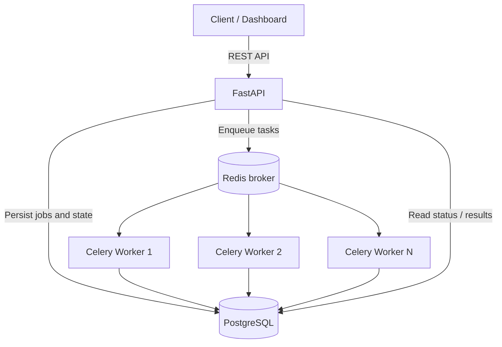
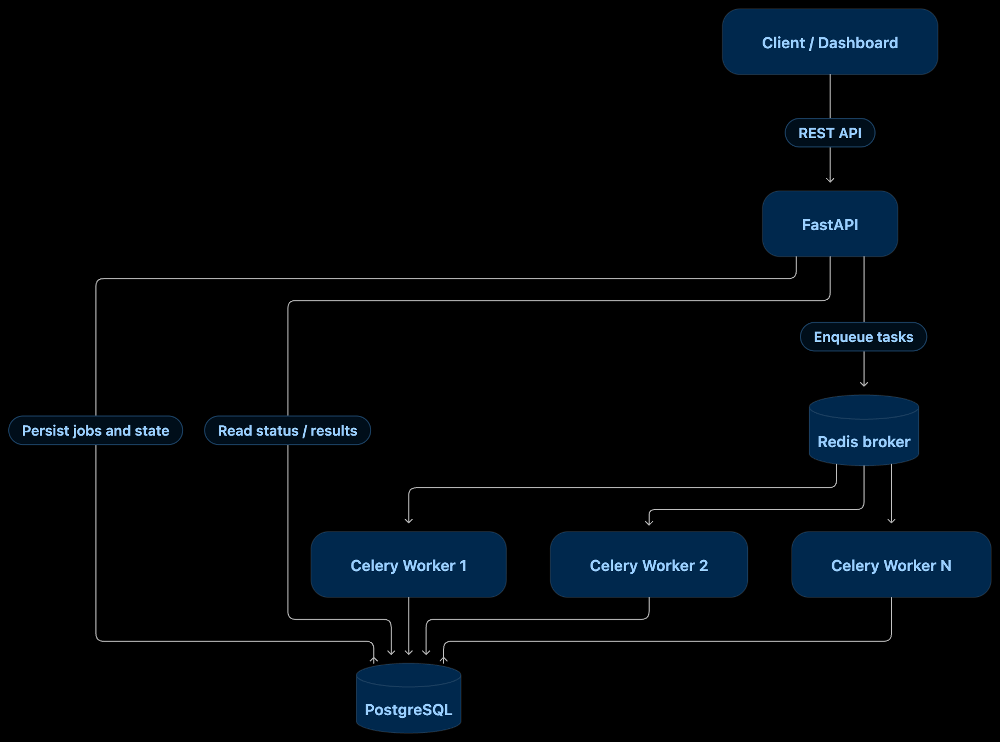

# FlowGrid

### A Distributed Workflow & Background Task Processing Platform

> **Status: In planning / initial development.** This README describes the system I intend to build. Architecture diagrams, endpoints, and examples are **proposed**, not claims that they are already working.

## Why I'm building this

A lot of backend applications need to do work that shouldn't happen inside an HTTP request: process large files, call external APIs, send notifications, or run jobs that take minutes rather than milliseconds.

Putting that work directly in an API request makes the application slower and harder to recover when something fails. Even after moving tasks to a queue, questions remain: What happens if a worker crashes? What if the same task runs twice? How do I know which step failed?

I'm building **FlowGrid** to explore those problems by creating a backend system that accepts jobs through an API, processes them using workers, and tracks what happened from start to finish.

The goal is **not** to clone Temporal or build every distributed-systems feature at once. It's to build one reliable end-to-end path, understand its failure modes, and then add more advanced workflow orchestration.

## The problem

Imagine a service needs to process 10,000 customer records. Each record might need to be validated, enriched, stored, and followed by a notification.

Doing all of that in a single request introduces timeouts and makes retries difficult. Running all the work on one server limits throughput. If a process dies halfway through, the system needs to know what completed, what failed, and what can safely run again.

**FlowGrid's approach:** submit a job, place it on a queue, execute it in a worker, persist its state, and provide an API to inspect the result. Later, connect multiple tasks into a workflow.

## Who it's for

- **Backend developers** who need to offload long-running jobs.
- **Small engineering teams** that want visibility into execution status, failures, and retries.
- **Developers learning distributed systems**, including me, who want to see reliability concepts working in a real application.

## Features and scope

These are **planned features**. A checked box will mean a feature is implemented and tested; currently, none are marked complete.

### Phase 1 — End-to-end MVP

- [ ] Submit an allow-listed job through a REST API.
- [ ] Validate incoming payloads and create a persistent job record.
- [ ] Dispatch work through a queue and execute it in a background worker.
- [ ] Fetch job status and output by ID.
- [ ] Store execution timestamps, errors, and attempt counts in PostgreSQL.
- [ ] Run API, worker, PostgreSQL, and Redis locally with Docker Compose.
- [ ] Add automated tests for the main happy path and failed jobs.

### Phase 2 — Reliability and security

- [ ] Retry transient failures with exponential backoff and a retry limit.
- [ ] Support idempotency keys for job submission.
- [ ] Make task handlers idempotent where possible to limit duplicate side effects.
- [ ] Track terminal failures for manual inspection / replay (dead-letter handling).
- [ ] Add timeouts, structured logs, and API input validation.
- [ ] Add authentication and basic rate limiting.
- [ ] Test worker termination, retries, and recovery behavior.

### Phase 3 — Workflow orchestration

- [ ] Define multi-step workflows with task dependencies (DAGs).
- [ ] Schedule jobs and workflows for later execution.
- [ ] Run multiple worker instances and test throughput.
- [ ] Add a dashboard for job history, attempts, and failures.
- [ ] Expose live progress through Server-Sent Events (SSE) or WebSockets.
- [ ] Add operational metrics and deployment documentation.

**Not in the initial scope:** running arbitrary user-uploaded code, guaranteeing exactly-once execution, or writing a full visual drag-and-drop workflow editor.

## Proposed architecture



**Initial design:** a FastAPI application accepts jobs, PostgreSQL stores job metadata and state, Redis acts as the message broker, and Celery workers run allow-listed task handlers. The API reads results from PostgreSQL rather than treating the queue as the source of truth.

This is a starting architecture, **not a production reliability guarantee**. In particular, saving a job to PostgreSQL and publishing it to Redis are two separate operations. A later enhancement may use a **transactional outbox** or reconciliation process so jobs are not silently stranded between those steps.

### Planned stack

| Layer | Technology | Purpose |
| --- | --- | --- |
| API | Python, FastAPI, Pydantic | HTTP endpoints and request validation |
| Job execution | Celery | Background task workers and retry mechanisms |
| Message broker | Redis | Queue delivery to workers |
| Primary database | PostgreSQL | Persistent jobs, attempts, and results |
| ORM / migrations | SQLAlchemy, Alembic | Data access and schema changes |
| Local environment | Docker Compose | Reproducible multi-service setup |
| Testing | Pytest | API, worker, and failure-path tests |
| Future monitoring | Prometheus / Grafana | Metrics and dashboards |
| Future UI | React / Next.js | Job and workflow management |

## How a job will run

1. A client submits a supported job type and payload to `POST /api/v1/jobs`.
2. FastAPI validates the request and creates a job record in PostgreSQL.
3. The backend publishes a task to Redis for a Celery worker to consume.
4. A worker starts execution and records the attempt and status.
5. When execution finishes, the result or error is persisted.
6. The client checks `GET /api/v1/jobs/{job_id}` for the latest state.
7. If the job fails for a retryable reason, the system retries under a bounded policy (Phase 2).

### Proposed job lifecycle

<p align="center">
  
</p>
The exact transitions will be refined during implementation. `DEAD_LETTER` is a planned application-level terminal state, not a built-in guarantee provided automatically by Redis or Celery.

## Proposed API

The following endpoints and request bodies are **design examples**, not currently available routes.

| Method | Endpoint | What it will do | Phase |
| --- | --- | --- | --- |
| `POST` | `/api/v1/jobs` | Submit a supported job | 1 |
| `GET` | `/api/v1/jobs/{job_id}` | Get status, timestamps, result, and error | 1 |
| `GET` | `/api/v1/jobs` | List jobs with filters and pagination | 1–2 |
| `GET` | `/api/v1/jobs/{job_id}/attempts` | Inspect retries and execution history | 2 |
| `POST` | `/api/v1/workflows` | Create a multi-step workflow | 3 |
| `POST` | `/api/v1/workflows/{workflow_id}/runs` | Start a workflow run | 3 |
| `GET` | `/api/v1/workflows/{workflow_id}/runs/{run_id}` | Inspect a workflow run | 3 |

### Example: submitting a job *(proposed contract)*

```http
POST /api/v1/jobs
Content-Type: application/json
Idempotency-Key: batch-2026-001
```

```json
{
  "type": "process_records",
  "payload": {
    "batch_id": "batch-001",
    "record_ids": [101, 102, 103]
  }
}
```

Possible response:

```json
{
  "job_id": "job_01",
  "status": "QUEUED",
  "created_at": "2026-11-11T10:00:00Z"
}
```

Example status response:

```json
{
  "job_id": "job_01",
  "status": "SUCCEEDED",
  "attempts": 1,
  "result": {
    "processed": 3,
    "failed": 0
  }
}
```

**Note:** `Idempotency-Key` is planned for Phase 2; the example illustrates the intended final API rather than the Phase 1 minimum.

## Data model (initial proposal)

| Entity | Important fields | Reason |
| --- | --- | --- |
| `jobs` | `id`, `type`, `payload`, `status`, `result`, `created_at`, `started_at`, `finished_at` | Track each submitted job |
| `job_attempts` | `id`, `job_id`, `attempt_number`, `worker_id`, `started_at`, `finished_at`, `error` | Understand retries and failures |
| `idempotency_keys` | `key`, `request_hash`, `job_id`, `created_at` | Deduplicate submissions (Phase 2) |
| `workflows` | `id`, `name`, `definition`, `created_at` | Store workflow definitions (Phase 3) |
| `workflow_runs` | `id`, `workflow_id`, `status`, `created_at`, `finished_at` | Track executions (Phase 3) |

The schema will evolve when I implement and test concurrency, retries, and workflow dependencies.

## Reliability decisions I want to test

### 1. At-least-once delivery is not exactly-once execution

A worker can finish an external side effect and crash before acknowledging a message. The same task may run again. I will not assume that Redis and Celery magically prevent duplicates; task handlers need idempotency or deduplication strategies.

### 2. Retry only when retrying makes sense

A temporary network timeout may be retryable. Invalid input probably is not. Retries will use a limit and backoff instead of running forever.

### 3. Keep enough state to explain failures

A job should not simply disappear from a queue. I want a record of attempts, timestamps, errors, and outcomes so I can debug failures and demonstrate the behavior clearly.

### 4. Treat worker failure as a test case

I plan to kill a worker during execution and verify what happens to the job, whether the message is redelivered, and whether repeated execution causes incorrect side effects. Behavior will depend on worker acknowledgement, visibility-timeout, and handler settings; it needs to be verified, not assumed.

## Proposed repository structure

```text
flowgrid/
├── app/
│   ├── api/                 # FastAPI routes
│   ├── core/                # Configuration, logging, security
│   ├── db/                  # Database setup and models
│   ├── schemas/             # Pydantic models
│   ├── services/            # Job submission and state logic
│   ├── tasks/               # Celery tasks and handlers
│   └── main.py              # FastAPI entry point
├── migrations/              # Alembic migrations
├── tests/                   # Unit and integration tests
├── docs/                    # Architecture and decisions
├── docker-compose.yml
├── Dockerfile
├── pyproject.toml
├── .env.example
└── README.md
```


This tree is a **target layout**, not a statement that these files already exist.

## Local development

**The application has not been implemented yet, so there are no verified setup commands or runnable API endpoints at this stage.** Once the initial scaffold exists, this section will include the exact installation, environment variables, migrations, startup commands, and tests.

The intended local dependencies are:

- Python 3.11+ and a package manager
- Docker and Docker Compose
- PostgreSQL and Redis (started with Compose)

I will document a reproducible one-command startup workflow when it is actually working.

## How I plan to evaluate it

I don't want to judge the project only by whether requests return `200 OK`.

| Scenario | What I want to verify |
| --- | --- |
| Submit a valid job | It is persisted, queued, executed, and queryable |
| Submit an invalid payload | API rejects it without creating unintended work |
| Run multiple jobs concurrently | Status remains accurate under load |
| Stop a worker mid-task | Recovery and re-delivery behavior are understood |
| Force a transient failure | Retry policy works and stops at its configured limit |
| Submit the same idempotency key twice | Only the intended logical job is created |
| Restart services | Persisted jobs remain visible and recoverable |
| Increase worker count | Throughput can be measured and compared |

I'll publish actual numbers—throughput, latency, success rate, and duplicate side effects—**only after running reproducible tests**.

## Development roadmap

- **Milestone 1:** API + database + one background task working end to end.
- **Milestone 2:** Job history, retries, failure handling, idempotency, and tests.
- **Milestone 3:** Workflow dependencies, scheduling, worker scaling, observability, and a dashboard.

## What I expect to learn

My main goal is to learn how backend systems behave beyond the happy path: queues, worker concurrency, durable state, safe retries, failure recovery, API design, database transactions, and observability. I want to be able to explain **why** the architecture works, where it breaks, and how I tested it.

---

**Project type:** Backend Engineering · Distributed Systems · Python

**Current stage:** Proposed / under development
