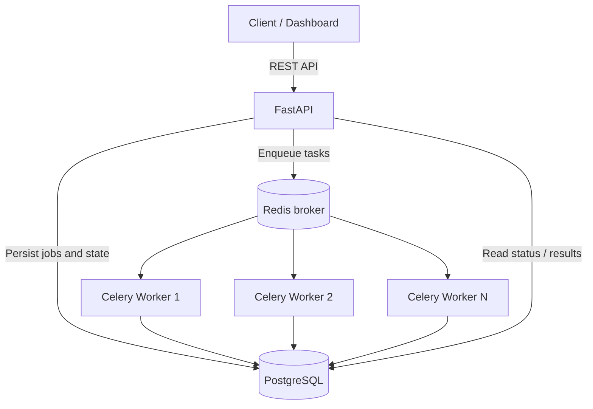
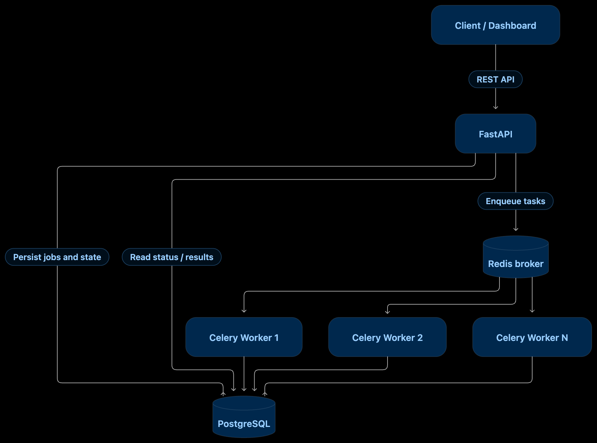

# FlowGrid

### A Distributed Workflow & Background Task Processing Platform

> **Status: Phase 1 (end-to-end MVP) and Phase 2 (reliability & security) implemented and tested.** Phase 3 items below are still **proposed**. Read the build write-ups in [`docs/blog/`](docs/blog/).

## Why I'm building this

A lot of backend applications need to do work that shouldn't happen inside an HTTP request: process large files, call external APIs, send notifications, or run jobs that take minutes rather than milliseconds.

Putting that work directly in an API request makes the application slower and harder to recover when something fails. Even after moving tasks to a queue, questions remain: What happens if a worker crashes? What if the same task runs twice? How do I know which step failed?

I'm building **FlowGrid** to explore those problems by creating a backend system that accepts jobs through an API, processes them using workers, and tracks what happened from start to finish.

The goal is **not** to clone Temporal or build every distributed-systems feature at once. It's to build one reliable end-to-end path, understand its failure modes, and then add more advanced workflow orchestration.

## The problem

Imagine a service needs to process 10,000 customer records. Each record might need to be validated, enriched, stored, and followed by a notification.

Doing all of that in a single request introduces timeouts and makes retries difficult. Running all the work on one server limits throughput. If a process dies halfway through, the system needs to know what completed, what failed, and what can safely run again.

**FlowGrid's approach:** submit a job, place it on a queue, execute it in a worker, persist its state, and provide an API to inspect the result. Later, connect multiple tasks into a workflow.

## Who it's for

- **Backend developers** who need to offload long-running jobs.
- **Small engineering teams** that want visibility into execution status, failures, and retries.
- **Developers learning distributed systems**, including me, who want to see reliability concepts working in a real application.

## Features and scope

A checked box means the feature is implemented and covered by tests (pytest suite on SQLite and PostgreSQL, plus `scripts/smoke_test.py` and `scripts/chaos_test.py` against the real Docker stack).

### Phase 1 — End-to-end MVP

- [x] Submit an allow-listed job through a REST API.
- [x] Validate incoming payloads and create a persistent job record.
- [x] Dispatch work through a queue and execute it in a background worker.
- [x] Fetch job status and output by ID.
- [x] Store execution timestamps, errors, and attempt counts in PostgreSQL.
- [x] Run API, worker, PostgreSQL, and Redis locally with Docker Compose.
- [x] Add automated tests for the main happy path and failed jobs.
- [x] Basic dashboard to submit jobs and watch their status (served at `/`).

### Phase 2 — Reliability and security

- [x] Retry transient failures with exponential backoff and a retry limit.
- [x] Support idempotency keys for job submission.
- [x] Make task handlers idempotent where possible to limit duplicate side effects.
- [x] Track terminal failures for manual inspection / replay (dead-letter handling).
- [x] Add timeouts, structured logs, and API input validation.
- [x] Add authentication and basic rate limiting.
- [x] Test worker termination, retries, and recovery behavior.
- [x] Recover jobs from dead workers (leases + sweeper) and from broker outages (outbox relay).

### Phase 3 — Workflow orchestration

- [ ] Define multi-step workflows with task dependencies (DAGs).
- [ ] Schedule jobs and workflows for later execution.
- [ ] Run multiple worker instances and test throughput.
- [ ] Add a dashboard for job history, attempts, and failures.
- [ ] Expose live progress through Server-Sent Events (SSE) or WebSockets.
- [ ] Add operational metrics and deployment documentation.

**Not in the initial scope:** running arbitrary user-uploaded code, guaranteeing exactly-once execution, or writing a full visual drag-and-drop workflow editor.

## Proposed architecture



**Initial design:** a FastAPI application accepts jobs, PostgreSQL stores job metadata and state, Redis acts as the message broker, and Celery workers run allow-listed task handlers. The API reads results from PostgreSQL rather than treating the queue as the source of truth.

This is **not a production reliability guarantee**, but Phase 2 closes the main gaps: saving a job to PostgreSQL and publishing it to Redis are still two separate operations, so a job that misses its publish stays `PENDING` and a **sweeper** process re-publishes it (an outbox relay). The same sweeper recovers `RUNNING` jobs whose worker died (lease expiry) and re-queues retries once their backoff has passed. See the [Phase 2 write-up](docs/blog/phase-2-reliability-and-security.md).

### Planned stack

| Layer | Technology | Purpose |
| --- | --- | --- |
| API | Python, FastAPI, Pydantic | HTTP endpoints and request validation |
| Job execution | Celery | Background task workers and retry mechanisms |
| Message broker | Redis | Queue delivery to workers |
| Primary database | PostgreSQL | Persistent jobs, attempts, and results |
| ORM / migrations | SQLAlchemy, Alembic | Data access and schema changes |
| Local environment | Docker Compose | Reproducible multi-service setup |
| Testing | Pytest | API, worker, and failure-path tests |
| Future monitoring | Prometheus / Grafana | Metrics and dashboards |
| Future UI | React / Next.js | Job and workflow management |

## How a job will run

1. A client submits a supported job type and payload to `POST /api/v1/jobs`.
2. FastAPI validates the request and creates a job record in PostgreSQL.
3. The backend publishes a task to Redis for a Celery worker to consume.
4. A worker starts execution and records the attempt and status.
5. When execution finishes, the result or error is persisted.
6. The client checks `GET /api/v1/jobs/{job_id}` for the latest state.
7. If the job fails for a retryable reason, the system retries under a bounded policy (Phase 2).

### Proposed job lifecycle

<p align="center">
  
</p>
Implemented lifecycle (Phase 2):

```text
PENDING ──publish──▶ QUEUED ──claim──▶ RUNNING ──▶ SUCCEEDED
   ▲                                     │
   │ backoff elapsed (sweeper)           ├─ transient error / timeout / lease expired
   └────────── RETRY_SCHEDULED ◀─────────┤     (attempts left)
                                         ├─ transient, attempts exhausted ──▶ DEAD_LETTER
                                         └─ permanent error ──────────────▶ FAILED
```

`DEAD_LETTER` and `FAILED` are application-level terminal states stored in PostgreSQL, not features of Redis or Celery. Both can be replayed as a new job via `POST /api/v1/jobs/{id}/replay`.

## Proposed API

Routes marked ✅ are implemented. The others are still **design examples**. All `/api/v1` routes require `Authorization: Bearer <api key>` and are rate limited per key.

| Method | Endpoint | What it will do | Phase |
| --- | --- | --- | --- |
| `POST` | `/api/v1/jobs` | Submit a supported job (returns `202 Accepted`) | 1 ✅ |
| `GET` | `/api/v1/jobs/{job_id}` | Get status, timestamps, result, and error | 1 ✅ |
| `GET` | `/api/v1/jobs` | List jobs with filters (`status`, `type`) and pagination | 1 ✅ |
| `GET` | `/api/v1/jobs/stats` | Job counts by status | 1 ✅ |
| `GET` | `/api/v1/job-types` | Allow-listed job types and their payload schemas | 1 ✅ |
| `GET` | `/health` | PostgreSQL + Redis connectivity | 1 ✅ |
| `GET` | `/api/v1/jobs/{job_id}/attempts` | Inspect retries and execution history | 2 ✅ |
| `POST` | `/api/v1/jobs/{job_id}/replay` | Re-run a `FAILED` / `DEAD_LETTER` job as a new job | 2 ✅ |
| `GET` | `/api/v1/me` | Which API key is calling | 2 ✅ |
| `POST` | `/api/v1/workflows` | Create a multi-step workflow | 3 |
| `POST` | `/api/v1/workflows/{workflow_id}/runs` | Start a workflow run | 3 |
| `GET` | `/api/v1/workflows/{workflow_id}/runs/{run_id}` | Inspect a workflow run | 3 |

### Example: submitting a job *(proposed contract)*

```http
POST /api/v1/jobs
Content-Type: application/json
Idempotency-Key: batch-2026-001
```

```json
{
  "type": "process_records",
  "payload": {
    "batch_id": "batch-001",
    "record_ids": [101, 102, 103]
  }
}
```

Possible response:

```json
{
  "job_id": "job_01",
  "status": "QUEUED",
  "created_at": "2026-11-11T10:00:00Z"
}
```

Example status response:

```json
{
  "job_id": "job_01",
  "status": "SUCCEEDED",
  "attempts": 1,
  "result": {
    "processed": 3,
    "failed": 0
  }
}
```

**Note:** `Idempotency-Key` is implemented (Phase 2): repeating a request with the same key returns the original job with `200` and `Idempotent-Replayed: true`; reusing the key with a different body returns `409`.

## Data model

| Entity | Important fields | Reason |
| --- | --- | --- |
| `jobs` | `id`, `api_key_id`, `type`, `payload`, `status`, `result`, `error`, `attempts`, `max_attempts`, `timeout_seconds`, `next_attempt_at`, `lease_expires_at`, `replay_of`, timestamps | Track each submitted job ✅ |
| `api_keys` | `id`, `name`, `prefix`, `key_hash`, `revoked_at` | Authenticate clients; only a SHA-256 hash is stored ✅ |
| `job_attempts` | `id`, `job_id`, `attempt_number`, `status`, `worker_id`, `error`, `error_type`, `retryable`, `started_at`, `finished_at` | Understand retries and failures ✅ |
| `idempotency_keys` | (`api_key_id`, `key`), `request_hash`, `job_id`, `created_at` | Deduplicate submissions ✅ |
| `processed_records`, `notifications` | unique (`batch_id`, `record_id`) / unique `dedupe_key` | Idempotent side effects of `process_records` ✅ |
| `workflows` | `id`, `name`, `definition`, `created_at` | Store workflow definitions (Phase 3) |
| `workflow_runs` | `id`, `workflow_id`, `status`, `created_at`, `finished_at` | Track executions (Phase 3) |

The schema will evolve when I implement and test concurrency, retries, and workflow dependencies.

## Reliability decisions I want to test

### 1. At-least-once delivery is not exactly-once execution

A worker can finish an external side effect and crash before acknowledging a message. The same task may run again. I will not assume that Redis and Celery magically prevent duplicates; task handlers need idempotency or deduplication strategies.

### 2. Retry only when retrying makes sense

A temporary network timeout may be retryable. Invalid input probably is not. Retries will use a limit and backoff instead of running forever.

### 3. Keep enough state to explain failures

A job should not simply disappear from a queue. I want a record of attempts, timestamps, errors, and outcomes so I can debug failures and demonstrate the behavior clearly.

### 4. Treat worker failure as a test case

I plan to kill a worker during execution and verify what happens to the job, whether the message is redelivered, and whether repeated execution causes incorrect side effects. Behavior will depend on worker acknowledgement, visibility-timeout, and handler settings; it needs to be verified, not assumed.

## Proposed repository structure

```text
flowgrid/
├── app/
│   ├── api/                 # FastAPI routes
│   ├── core/                # Configuration, logging, security
│   ├── db/                  # Database setup and models
│   ├── schemas/             # Pydantic models
│   ├── services/            # Job submission and state logic
│   ├── tasks/               # Celery tasks and handlers
│   └── main.py              # FastAPI entry point
├── migrations/              # Alembic migrations
├── tests/                   # Unit and integration tests
├── docs/                    # Architecture and decisions
├── docker-compose.yml
├── Dockerfile
├── pyproject.toml
├── .env.example
└── README.md
```


The code follows this layout, plus `app/static/` (dashboard), `app/sweeper.py` + `app/cli.py` (sweeper process and admin CLI), `scripts/` (smoke and chaos tests) and a `Makefile`.

## Local development

**Requirements:** Docker (with Compose v2+), Python 3.11+, `make`.

```bash
# 1. Start PostgreSQL, Redis, migrations, the API, a Celery worker and the sweeper
make up

# 2. Create an API key (shown once; only its hash is stored)
make api-key NAME=my-laptop

# 3. Open the dashboard and paste the key in the top-right box
open http://localhost:8000          # API docs: http://localhost:8000/docs

# 4. End-to-end and failure-injection checks against the real stack
python3 -m venv .venv && .venv/bin/pip install -e ".[dev]"
make smoke
make chaos
```

Submit a job from the command line:

```bash
curl -s -X POST localhost:8000/api/v1/jobs \
  -H "Authorization: Bearer $FLOWGRID_API_KEY" -H 'Content-Type: application/json' \
  -H 'Idempotency-Key: batch-001' \
  -d '{"type": "process_records", "payload": {"batch_id": "b1", "record_ids": [101, 102, 103]}, "max_attempts": 5}'
```

| Command | What it does |
| --- | --- |
| `make up` / `make down` | Start / stop the stack (`make clean` also deletes the DB volume) |
| `make api-key NAME=…` | Create an API key (`python -m app.cli list-api-keys` / `revoke-api-key` for the rest) |
| `make logs` | Follow API, worker and sweeper logs (JSON) |
| `make test` | Run the pytest suite locally against SQLite (no services needed) |
| `make test-pg` | Run the pytest suite inside Docker against PostgreSQL |
| `make smoke` | Run `scripts/smoke_test.py` against the running stack |
| `make chaos` | Run `scripts/chaos_test.py`: kills the worker, stops Redis, forces timeouts (~1 min) |

**Available job types:** `echo`, `sleep`, `flaky` (fails N times then succeeds), `process_records` (idempotent writes + notifications), `always_fail` (`transient: true` → retried then `DEAD_LETTER`). `GET /api/v1/job-types` returns each one's JSON schema, example payload and default timeout.

All tunables (retry backoff, lease grace, rate limits, sweeper interval…) are environment variables; see [`.env.example`](.env.example).

> The Makefile sets `COMPOSE_BAKE=false`; see the Phase 1 blog post for why (the project path contains an em dash).

## How I plan to evaluate it

I don't want to judge the project only by whether requests return `200 OK`.

| Scenario | What I want to verify |
| --- | --- |
| Submit a valid job | It is persisted, queued, executed, and queryable |
| Submit an invalid payload | API rejects it without creating unintended work |
| Run multiple jobs concurrently | Status remains accurate under load |
| Stop a worker mid-task | Recovery and re-delivery behavior are understood |
| Force a transient failure | Retry policy works and stops at its configured limit |
| Submit the same idempotency key twice | Only the intended logical job is created |
| Restart services | Persisted jobs remain visible and recoverable |
| Increase worker count | Throughput can be measured and compared |

I'll publish actual numbers—throughput, latency, success rate, and duplicate side effects—**only after running reproducible tests**.

## Development roadmap

- **Milestone 1:** API + database + one background task working end to end.
- **Milestone 2:** Job history, retries, failure handling, idempotency, and tests.
- **Milestone 3:** Workflow dependencies, scheduling, worker scaling, observability, and a dashboard.

## What I expect to learn

My main goal is to learn how backend systems behave beyond the happy path: queues, worker concurrency, durable state, safe retries, failure recovery, API design, database transactions, and observability. I want to be able to explain **why** the architecture works, where it breaks, and how I tested it.

---

**Project type:** Backend Engineering · Distributed Systems · Python

**Current stage:** Phase 1 and Phase 2 complete · Phase 3 (workflow orchestration) next
