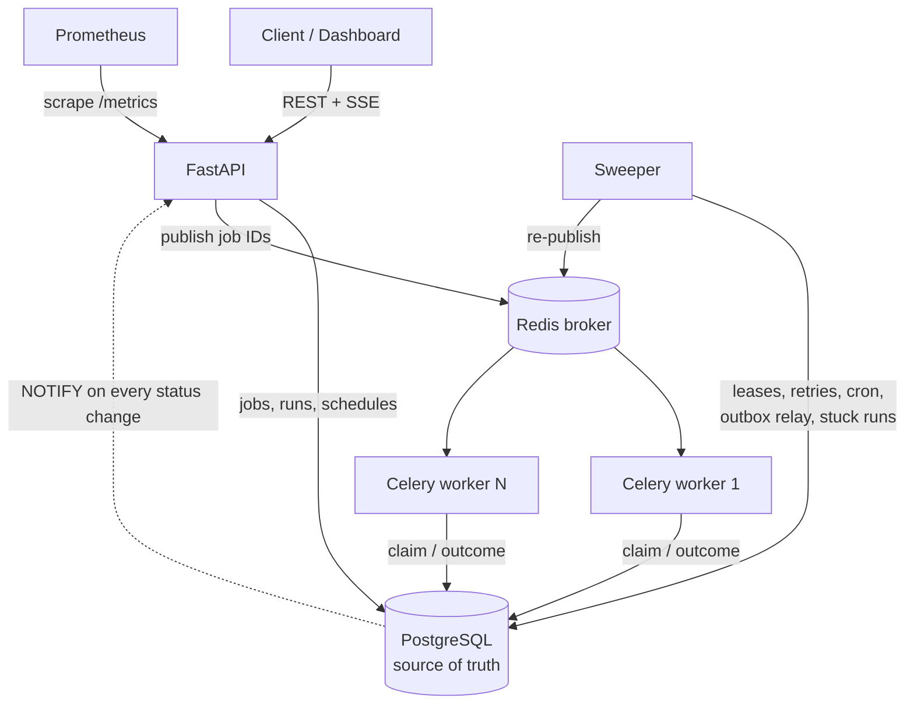

# FlowGrid

### A Distributed Workflow & Background Task Processing Platform

> **Status: all three phases implemented and tested** (end-to-end MVP · reliability & security · workflow orchestration). Read how each phase was built, what broke and how it was verified in the [build log](docs/blog/).

## Why I'm building this

A lot of backend applications need to do work that shouldn't happen inside an HTTP request: process large files, call external APIs, send notifications, or run jobs that take minutes rather than milliseconds.

Putting that work directly in an API request makes the application slower and harder to recover when something fails. Even after moving tasks to a queue, questions remain: What happens if a worker crashes? What if the same task runs twice? How do I know which step failed?

I'm building **FlowGrid** to explore those problems by creating a backend system that accepts jobs through an API, processes them using workers, and tracks what happened from start to finish.

The goal is **not** to clone Temporal or build every distributed-systems feature at once. It's to build one reliable end-to-end path, understand its failure modes, and then add more advanced workflow orchestration.

## The problem

Imagine a service needs to process 10,000 customer records. Each record might need to be validated, enriched, stored, and followed by a notification.

Doing all of that in a single request introduces timeouts and makes retries difficult. Running all the work on one server limits throughput. If a process dies halfway through, the system needs to know what completed, what failed, and what can safely run again.

**FlowGrid's approach:** submit a job, place it on a queue, execute it in a worker, persist its state, and provide an API to inspect the result. Later, connect multiple tasks into a workflow.

## Who it's for

- **Backend developers** who need to offload long-running jobs.
- **Small engineering teams** that want visibility into execution status, failures, and retries.
- **Developers learning distributed systems**, including me, who want to see reliability concepts working in a real application.

## Features and scope

A checked box means the feature is implemented and covered by tests (pytest suite on SQLite and PostgreSQL, plus `scripts/smoke_test.py` and `scripts/chaos_test.py` against the real Docker stack).

### Phase 1 — End-to-end MVP

- [x] Submit an allow-listed job through a REST API.
- [x] Validate incoming payloads and create a persistent job record.
- [x] Dispatch work through a queue and execute it in a background worker.
- [x] Fetch job status and output by ID.
- [x] Store execution timestamps, errors, and attempt counts in PostgreSQL.
- [x] Run API, worker, PostgreSQL, and Redis locally with Docker Compose.
- [x] Add automated tests for the main happy path and failed jobs.
- [x] Basic dashboard to submit jobs and watch their status (served at `/`).

### Phase 2 — Reliability and security

- [x] Retry transient failures with exponential backoff and a retry limit.
- [x] Support idempotency keys for job submission.
- [x] Make task handlers idempotent where possible to limit duplicate side effects.
- [x] Track terminal failures for manual inspection / replay (dead-letter handling).
- [x] Add timeouts, structured logs, and API input validation.
- [x] Add authentication and basic rate limiting.
- [x] Test worker termination, retries, and recovery behavior.
- [x] Recover jobs from dead workers (leases + sweeper) and from broker outages (outbox relay).

### Phase 3 — Workflow orchestration

- [x] Define multi-step workflows with task dependencies (DAGs).
- [x] Schedule jobs and workflows for later execution.
- [x] Run multiple worker instances and test throughput.
- [x] Add a dashboard for job history, attempts, and failures.
- [x] Expose live progress through Server-Sent Events (SSE) or WebSockets.
- [x] Add operational metrics and deployment documentation.

**Not in the initial scope:** running arbitrary user-uploaded code, guaranteeing exactly-once execution, or writing a full visual drag-and-drop workflow editor.

## Architecture



<p align="center">
  
</p>

**Design:** FastAPI accepts and validates work, PostgreSQL stores every job, attempt, workflow run and schedule, Redis only carries job IDs to Celery workers, and a **sweeper** process drives everything time-based or recovery-related from database state (expired leases, due retries, delayed jobs, cron ticks, jobs that missed or lost their broker message, workflow runs left stuck by a crash). Status changes are pushed to clients through a PostgreSQL `NOTIFY` trigger and Server-Sent Events.

This is **not a guarantee of exactly-once execution** (nothing is): delivery is at-least-once. Duplicate *state transitions* are prevented by guarded `UPDATE`s with a per-attempt fencing token, and duplicate *side effects* by idempotent handlers. Every one of those claims is tested by killing real containers; see the [chaos results](#how-it-was-evaluated).

### Stack

| Layer | Technology | Purpose |
| --- | --- | --- |
| API | Python, FastAPI, Pydantic | HTTP endpoints, validation, SSE |
| Job execution | Celery (acks-late, soft/hard time limits) | Background workers |
| Message broker | Redis | Queue delivery; also the rate limiter's token buckets |
| Primary database | PostgreSQL | Jobs, attempts, workflows, runs, schedules; `LISTEN/NOTIFY` for live events |
| ORM / migrations | SQLAlchemy 2, Alembic | Data access and versioned schema (3 migrations) |
| Scheduling | croniter + the sweeper | Cron schedules, delayed jobs, retry backoff |
| Monitoring | Prometheus (`/metrics` + alert rules) | Queue age, sweeper lag, outcomes, HTTP latency |
| Dashboard | One static HTML/JS page (no build step) | Jobs, workflow DAGs, schedules, live updates |
| Local environment | Docker Compose | Reproducible multi-service setup, scalable workers |
| Testing | Pytest (SQLite + PostgreSQL), smoke, chaos and benchmark scripts | Correctness, failure recovery, throughput |

## How a job runs

1. A client submits an allow-listed job type and payload to `POST /api/v1/jobs` (or a batch, or a workflow run, or a cron schedule fires).
2. FastAPI validates it and commits a job row (`PENDING`, or `SCHEDULED` if it has a `run_at`).
3. The job ID is published to Redis and the job becomes `QUEUED`. If Redis is down it stays `PENDING` and the sweeper publishes it later (outbox).
4. A worker **claims** it (`QUEUED → RUNNING`, a guarded update that only one worker can win), records an attempt and a lease, and runs the handler.
5. The outcome is recorded, fenced by attempt number: `SUCCEEDED`, `RETRY_SCHEDULED` (transient error, with exponential backoff), `DEAD_LETTER` (retries exhausted) or `FAILED` (permanent error).
6. For workflow steps, dependents whose parents have all succeeded are unblocked; a failed step cancels the rest of the run.
7. Every change emits a `NOTIFY`; the dashboard updates live, and `GET /api/v1/jobs/{id}` always reflects PostgreSQL.

### Job lifecycle

```text
SCHEDULED ─run_at─┐            BLOCKED ─parents succeeded─┐   (workflow steps)
                  ▼                                       ▼
               PENDING ──publish──▶ QUEUED ──claim──▶ RUNNING ──▶ SUCCEEDED
                  ▲                                     │
                  │ backoff elapsed (sweeper)           ├─ transient error / timeout / lease expired
                  └────────── RETRY_SCHEDULED ◀─────────┤     (attempts left)
                                                        ├─ transient, attempts exhausted ──▶ DEAD_LETTER
                                                        └─ permanent error ──────────────▶ FAILED
   not yet started when its workflow fails or is cancelled ──────────────────────────────▶ CANCELLED
```

`DEAD_LETTER`, `FAILED` and `CANCELLED` are application-level terminal states stored in PostgreSQL, not features of Redis or Celery. Standalone failed jobs can be replayed as a new job via `POST /api/v1/jobs/{id}/replay`.

## API

All `/api/v1` routes require `Authorization: Bearer <api key>` and are rate limited per key (token bucket). Interactive docs at `/docs`.

| Method | Endpoint | What it does | Phase |
| --- | --- | --- | --- |
| `POST` | `/api/v1/jobs` | Submit a job (`202`); optional `Idempotency-Key`, `max_attempts`, `timeout_seconds`, `run_at` / `delay_seconds` | 1–3 |
| `POST` | `/api/v1/jobs/batch` | Submit up to 500 jobs atomically | 3 |
| `GET` | `/api/v1/jobs` | List with filters (`status`, `type`) and pagination | 1 |
| `GET` | `/api/v1/jobs/{job_id}` | Status, timestamps, result, error, workflow/schedule origin | 1 |
| `GET` | `/api/v1/jobs/{job_id}/attempts` | Every attempt: worker, outcome, error, duration | 2 |
| `POST` | `/api/v1/jobs/{job_id}/replay` | Re-run a `FAILED` / `DEAD_LETTER` job as a new job | 2 |
| `GET` | `/api/v1/jobs/stats` | Job counts by status | 1 |
| `GET` | `/api/v1/job-types` | Allow-listed job types, payload JSON schemas, examples | 1 |
| `POST` | `/api/v1/workflows` | Create a validated DAG workflow (`201`) | 3 |
| `GET` | `/api/v1/workflows`, `/api/v1/workflows/{id}` | List / inspect workflows (with DAG levels) | 3 |
| `POST` | `/api/v1/workflows/{workflow_id}/runs` | Start a run now or at `run_at` | 3 |
| `GET` | `/api/v1/workflows/{workflow_id}/runs/{run_id}` | Run status with every step's state and result | 3 |
| `POST` | `/api/v1/workflows/{workflow_id}/runs/{run_id}/cancel` | Cancel steps that have not started | 3 |
| `GET` | `/api/v1/workflow-runs` | Recent runs across all workflows | 3 |
| `POST` `GET` `PATCH` `DELETE` | `/api/v1/schedules[/{id}]` | Cron schedules for jobs or workflows; pause / resume | 3 |
| `GET` | `/api/v1/events` | Live job / run status changes (Server-Sent Events) | 3 |
| `GET` | `/api/v1/me` | Which API key is calling | 2 |
| `GET` | `/health`, `/health/live` | Readiness (PostgreSQL + Redis) / liveness | 1, 3 |
| `GET` | `/metrics` | Prometheus metrics (expose internally only) | 3 |

### Example: a workflow

```json
POST /api/v1/workflows
{
  "name": "nightly-import",
  "steps": [
    {"id": "extract", "type": "echo", "payload": {"message": "start"}},
    {"id": "batch_a", "type": "process_records", "depends_on": ["extract"],
     "payload": {"batch_id": "a", "record_ids": [1, 2, 3]}},
    {"id": "batch_b", "type": "process_records", "depends_on": ["extract"],
     "payload": {"batch_id": "b", "record_ids": [4, 5]}},
    {"id": "report", "type": "summarize", "depends_on": ["batch_a", "batch_b"]}
  ]
}
```

`batch_a` and `batch_b` run in parallel after `extract`; `report` receives both results (`ctx.upstream`) and sums them. Cycles, unknown dependencies, duplicate IDs and invalid step payloads are all rejected with `422` in one response.

## Data model

| Entity | Important fields | Purpose |
| --- | --- | --- |
| `jobs` | `type`, `payload`, `status`, `result`, `error`, `attempts`, `max_attempts`, `timeout_seconds`, `next_attempt_at`, `lease_expires_at`, `workflow_run_id`, `step_id`, `schedule_id`, `scheduled_for`, `replay_of` | Every unit of work |
| `job_attempts` | `attempt_number`, `status`, `worker_id`, `error_type`, `retryable`, timestamps | Retry and failure history |
| `workflows` | `name`, `definition` (validated DAG) | Workflow definitions |
| `workflow_runs` | `workflow_id`, `status`, `error`, `schedule_id`, `scheduled_for` | Workflow executions |
| `job_dependencies` | (`job_id`, `depends_on_job_id`) | DAG edges for one run |
| `schedules` | `cron`, `enabled`, target (job or workflow), `next_run_at` | Recurring triggers; one job per tick via unique (`schedule_id`, `scheduled_for`) |
| `api_keys` | `prefix`, `key_hash`, `revoked_at` | Authentication (SHA-256 hash only) |
| `idempotency_keys` | (`api_key_id`, `key`), `request_hash`, `job_id` | Deduplicate submissions |
| `processed_records`, `notifications` | unique (`batch_id`, `record_id`) / unique `dedupe_key` | Idempotent side effects |

## Reliability decisions and how they were tested

### 1. At-least-once delivery is not exactly-once execution

Late acknowledgement means a crashed worker's message is redelivered, so a job can arrive twice. Guarded claims and a fencing token make the *state* correct; idempotent writes make the *side effects* correct. **Tested:** 3 duplicate deliveries → `attempts` stays 1; a batch crashing at record 250/500 and retrying → 500 rows and 500 notifications, not 750.

### 2. Retry only when retrying makes sense

Only explicitly transient errors (and timeouts, lost workers) are retried, with exponential backoff and jitter, up to `max_attempts`; then `DEAD_LETTER`. Bugs and bad input fail immediately. **Tested** in unit tests and against the real stack.

### 3. Keep enough state to explain failures

Every attempt is a row with its worker, error type and retryability; every status change is an event; metrics show queue age and sweeper lag. **Tested:** the dashboard shows the full attempt history of a retried job.

### 4. Treat worker failure as a test case

`make chaos` SIGKILLs a worker mid-job and mid-workflow, stops Redis, flushes Redis's queue, forces timeouts and races three sweepers on one cron schedule. **All 8 scenarios recover to the correct state.**

## Repository structure

```text
├── app/
│   ├── api/          # Routes: jobs, workflows, schedules, events (SSE) + metrics, health
│   ├── core/         # Config, structured logging, middleware, Prometheus metrics
│   ├── db/           # Models, session, NOTIFY triggers
│   ├── schemas/      # Pydantic request/response models
│   ├── services/     # Job state machine, workflows, schedules, sweeper, retry, auth, rate limit, events
│   ├── tasks/        # Celery app, task, allow-listed handlers
│   ├── static/       # Dashboard (single HTML file)
│   ├── cli.py        # API key admin
│   ├── sweeper.py    # Sweeper process entry point
│   └── main.py       # FastAPI app factory
├── migrations/       # Alembic: 0001 jobs, 0002 reliability & security, 0003 workflows & schedules
├── tests/            # 122 tests (SQLite and PostgreSQL)
├── scripts/          # smoke_test.py, chaos_test.py, benchmark.py
├── deploy/prometheus # Scrape config + alert rules
├── docs/             # Build log (blog), deployment guide, benchmark results
├── docker-compose.yml · Dockerfile · Makefile · pyproject.toml · .env.example
```

## Local development

**Requirements:** Docker (with Compose v2+), Python 3.11+, `make`.

```bash
# 1. Start PostgreSQL, Redis, migrations, the API, a Celery worker and the sweeper
make up

# 2. Create an API key (shown once; only its hash is stored)
make api-key NAME=my-laptop

# 3. Open the dashboard and paste the key in the top-right box
open http://localhost:8000          # API docs: http://localhost:8000/docs

# 4. Verify against the real stack
python3 -m venv .venv && .venv/bin/pip install -e ".[dev]"
make smoke      # 19 end-to-end checks (~1.5 min)
make chaos      # 8 failure-injection scenarios (~3 min)
make bench      # throughput with 1, 2 and 4 workers (~2 min)
```

| Command | What it does |
| --- | --- |
| `make up` / `make down` | Start / stop the stack (`make clean` also deletes the DB volume) |
| `docker compose up -d --scale worker=4` | Run more workers (each runs `WORKER_CONCURRENCY`=2 processes) |
| `make api-key NAME=…` | Create an API key (`python -m app.cli list-api-keys` / `revoke-api-key` for the rest) |
| `make logs` | Follow API, worker and sweeper logs (JSON) |
| `make monitoring` | Start Prometheus on http://localhost:9090 with FlowGrid's alert rules |
| `make test` / `make test-pg` | Test suite on SQLite (no services) / on PostgreSQL in Docker |
| `make smoke` / `make chaos` / `make bench` | End-to-end checks / failure injection / throughput benchmark |

**Job types:** `echo`, `sleep`, `flaky` (fails N times then succeeds), `process_records` (idempotent writes + notifications), `summarize` (workflow fan-in), `always_fail` (`transient: true` → retried then `DEAD_LETTER`).

All tunables are environment variables; see [`.env.example`](.env.example). For production, see the [deployment guide](docs/deployment.md).

> The Makefile sets `COMPOSE_BAKE=false`; see the Phase 1 blog post for why (the project path contains an em dash).

## How it was evaluated

| Scenario | Result |
| --- | --- |
| Submit a valid job | Persisted, queued, executed and queryable; live events arrive ~10 ms after submit |
| Submit an invalid payload / cyclic workflow | Rejected with `422`; nothing is created |
| Run many jobs concurrently | 1,000-job batches, 0 lost, 0 duplicated, 0 retried |
| Stop a worker mid-task (SIGKILL) | Lease expires, job retried, `attempts = [LOST, SUCCEEDED]`; same inside a workflow |
| Force a transient failure | Retried with backoff; `DEAD_LETTER` after `max_attempts` |
| Same idempotency key twice | One job; different body → `409` |
| Redis down / Redis loses queued messages | Jobs accepted as `PENDING` / re-published by the sweeper; all complete |
| Three sweepers on one cron schedule | Exactly one job per tick |
| Restart services | All state is in PostgreSQL; nothing lost |
| Increase worker count | See below |

**Throughput** (all services on one 8-CPU Docker VM, 2 processes per worker; [full results](docs/benchmarks/phase-3-results.md)):

| Worker containers | Overhead (no-op jobs) | I/O-bound (0.2 s jobs) | I/O-bound vs ideal |
| --- | --- | --- | --- |
| 1 | 257 jobs/s | 9.1 jobs/s | 91% |
| 2 | 396 jobs/s | 17.9 jobs/s | 90% |
| 4 | 466 jobs/s | 35.2 jobs/s | 88% |

## Development roadmap

- **Phase 1 ✅** API + database + background worker end to end. ([write-up](docs/blog/phase-1-end-to-end-mvp.md))
- **Phase 2 ✅** Retries, timeouts, dead letters, idempotency, leases, outbox, auth, rate limiting. ([write-up](docs/blog/phase-2-reliability-and-security.md))
- **Phase 3 ✅** Workflow DAGs, scheduling, worker scaling, live events, metrics, deployment docs. ([write-up](docs/blog/phase-3-workflow-orchestration.md))

## What I expect to learn

My main goal is to learn how backend systems behave beyond the happy path: queues, worker concurrency, durable state, safe retries, failure recovery, API design, database transactions, and observability. I want to be able to explain **why** the architecture works, where it breaks, and how I tested it.

---

**Project type:** Backend Engineering · Distributed Systems · Python

**Current stage:** Phases 1–3 complete
